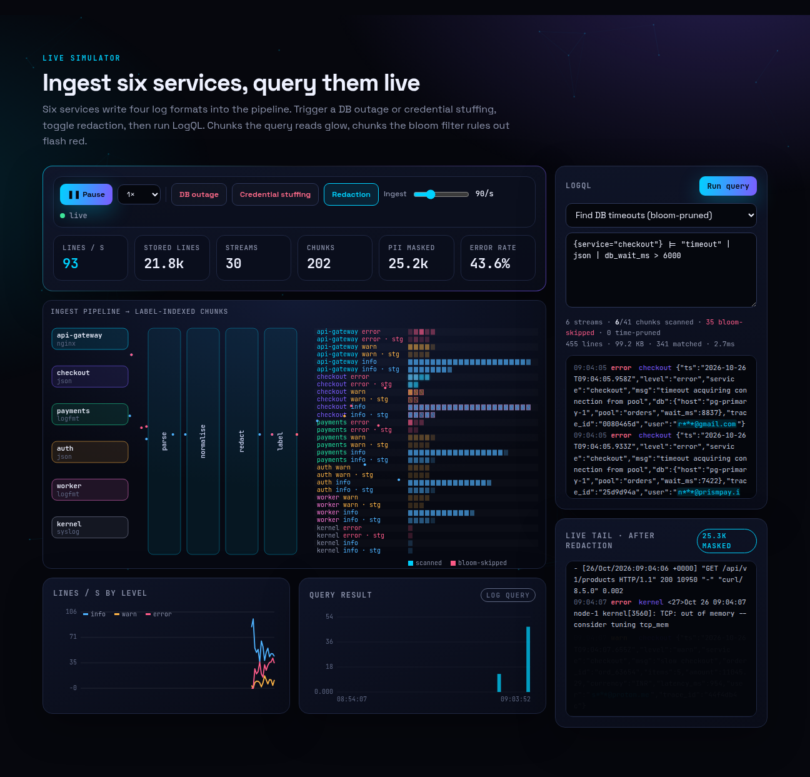
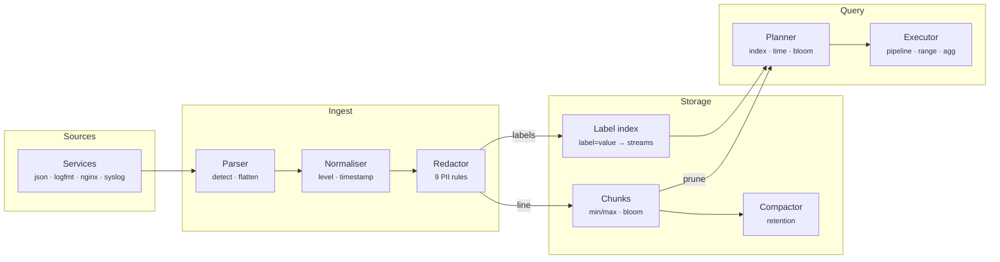
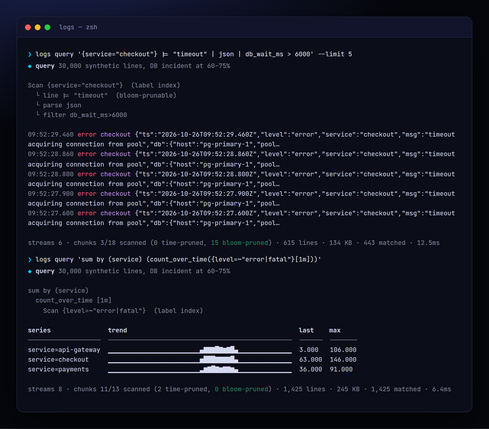
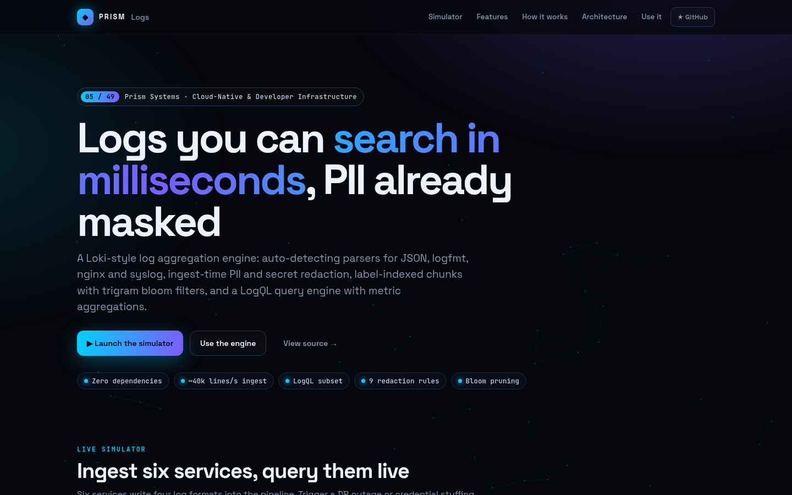
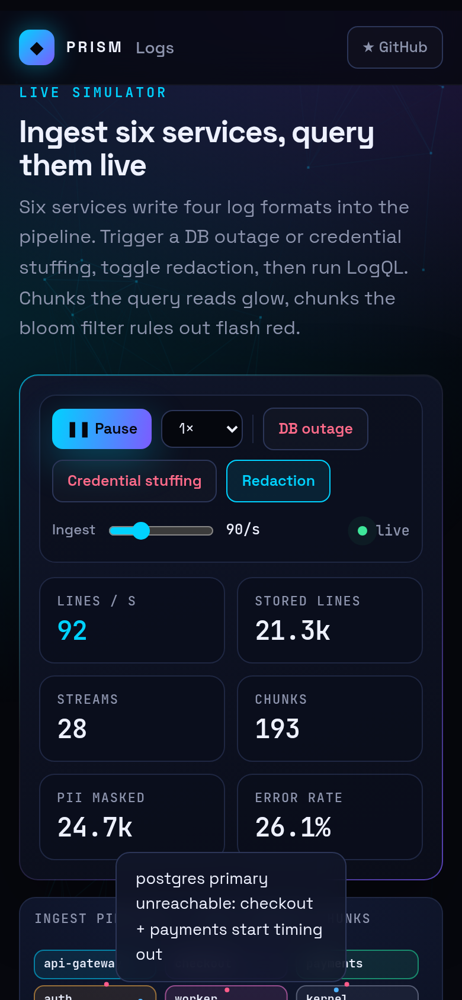

<!-- Prism Systems 05/49 -->
<p align="center">
  
</p>

<p align="center">
  
</p>

<p align="center">
  <a href="https://github.com/krishyaa06/prism-logs/actions/workflows/ci.yml"></a>
  <a href="https://krishyaa06.github.io/prism-logs/"></a>
  
  
  
  <a href="LICENSE"></a>
</p>

<p align="center">
  <a href="https://krishyaa06.github.io/prism-logs/"><b>Live simulator</b></a> ·
  <a href="docs/ARCHITECTURE.md"><b>Architecture</b></a> ·
  <a href="docs/USAGE.md"><b>Docs</b></a> ·
  <a href="#-quick-start"><b>Quick start</b></a>
</p>

<p align="center">
  <a href="https://krishyaa06.github.io/prism-logs/"></a>
</p>


## ⚡ Overview

Most log platforms either index everything (expensive) or nothing (slow). Prism Logs follows the Loki design: index a handful of labels, keep the raw lines in compressed-friendly chunks, and make brute-force scanning cheap by pruning chunks with time ranges and bloom filters. On top sits a LogQL engine, so the same query language that finds one bad request also turns logs into metrics and alerts. Redaction happens at ingest, so secrets never reach storage.

## ✨ Features

| | Feature | Details |
| :-: | --- | --- |
| ⇄ | **Format auto-detection** | JSON (nested fields flattened to `http_status`), logfmt, nginx/apache combined with `request_time`, RFC 3164 syslog and plain text. |
| ⚖ | **Normalisation** | Levels from `level`, `severity`, pino numbers, syslog PRI or HTTP status. Timestamps from ISO, epoch s/ms/ns or nginx dates. |
| ✱ | **Ingest-time redaction** | Emails, Luhn-valid cards, Aadhaar, phones, bearer tokens, JWTs, `sk_live_` / AWS / GitHub keys, passwords and IPv4 are masked before storage. |
| ▤ | **Label-indexed chunks** | Only low-cardinality labels are indexed. Each stream is a list of chunks with min/max time, sealed by size or age. |
| ◌ | **Trigram bloom filters** | Every chunk carries a 32 Kbit bloom of its trigrams, so `|= "timeout"` skips chunks that cannot match. No false negatives. |
| λ | **LogQL engine** | Selectors, line filters, `json`/`logfmt`/`pattern`/`regexp`, label filters with and/or, `line_format`, `unwrap`, `drop`/`keep`. |
| ∑ | **Metric queries** | `rate`, `count_over_time`, `bytes_rate`, `quantile_over_time`, `avg/min/max/sum_over_time`, `sum/avg/count by`, `topk`, `+ - * /`. |
| ⛨ | **Guard rails** | Retention compaction, a stream cardinality limit, out-of-order tolerance inside open chunks, and helpful parse errors. |

## 🏗️ Architecture



### How it works

1. **Parse** — Each line's format is detected, fields are extracted and flattened, and level and timestamp are normalised.
2. **Redact** — Nine rules mask PII and secrets in the raw line. Counts per rule are tracked for compliance reporting.
3. **Label** — Static labels (service, env) plus the normalised level form the stream key. High-cardinality fields stay in the line.
4. **Chunk** — Lines append to the stream's open chunk, which updates min/max time and the trigram bloom, then seals at 512 lines or 10 minutes.
5. **Query** — The planner resolves streams through the label index, prunes chunks by time and bloom, then streams lines through the compiled pipeline and range/vector aggregations.

More detail in [docs/ARCHITECTURE.md](docs/ARCHITECTURE.md).

## 🚀 Quick Start

**Try it in the browser:** [https://krishyaa06.github.io/prism-logs/](https://krishyaa06.github.io/prism-logs/), no install needed.

```bash
# CLI, no install
npx github:krishyaa06/prism-logs --help

# add the engine to a project
npm install github:krishyaa06/prism-logs
```

### JavaScript API

```js
import { LogStore, Ingestor, query, explain } from "prism-logs";

const store = new LogStore({ chunkLines: 512, retentionMs: 7 * 864e5 });
const ingest = new Ingestor(store, { labels: ["service", "env"] });   // redaction on by default

ingest.push('{"level":"error","msg":"timeout acquiring connection","db":{"wait_ms":7200},"user":"riya@gmail.com"}', { service: "checkout", env: "prod" });
ingest.push('ts=2026-10-26T10:00:00Z level=info msg="payment captured" psp=razorpay latency_ms=142', { service: "payments", env: "prod" });

const logs = query(store, '{service="checkout"} |= "timeout" | json | db_wait_ms > 6000', { limit: 50 });
console.log(logs.entries[0].line);           // ..."user":"r***@gmail.com"...
console.log(logs.stats);                     // { chunksScanned, chunksBloom, lines, bytes, ms, ... }

const errs = query(store, 'sum by (service) (rate({level="error"}[1m]))', { start, end, step: 15e3 });
console.log(errs.series);                    // [{ labels: { service }, values: [...] }]
console.log(explain(errs.ast));
```

| Export | What it does |
|---|---|
| `new LogStore({ chunkLines, chunkSpanMs, bloomBits, retentionMs, maxStreams })` | Label-indexed chunk store |
| `store.append(labels, ts, line)` · `select(matchers)` · `labelNames()` · `labelValues(name)` · `compact(now)` | Low-level storage API |
| `new Ingestor(store, { redact, rules, labels, format })` · `.push(line, labels)` · `.pushMany(lines, labels)` · `.stats` | Parse, redact, label, store |
| `query(store, logql, { start, end, step, limit, direction })` | `{ kind: "streams", entries }` or `{ kind: "matrix", series, steps }`, plus `stats` |
| `parse(logql)` · `explain(ast)` · `lex(logql)` | Parser and plan printer |
| `parseLine(line)` · `detect(line)` · `parseJSON` · `parseLogfmt` · `parseNginx` · `parseSyslog` · `normLevel` | Parsers |
| `redact(line, ruleIds?)` · `RULES` | Redaction |
| `Bloom` · `trigrams` · `Generator` | Building blocks and synthetic traffic |

### CLI

```bash
$ npx github:krishyaa06/prism-logs query '{service="checkout"} |= "timeout" | json | db_wait_ms > 6000'
$ npx github:krishyaa06/prism-logs query 'sum by (service) (count_over_time({level=~"error|fatal"}[1m]))'
$ npx github:krishyaa06/prism-logs query '{service="app"} | logfmt | latency_ms > 300' --file app.log --service app
$ cat app.log | npx github:krishyaa06/prism-logs redact -
$ npx github:krishyaa06/prism-logs bench --n 100000
```

<p align="center"></p>

| Command | Description |
|---|---|
| `logs query '<logql>' [--file f --service s] [--limit n] [--since 15m]` | Run a log or metric query (synthetic data if no file) |
| `logs explain '<logql>'` | Print the query plan |
| `logs parse '<line>'` | Show detected format, fields, level and timestamp |
| `logs redact <file or ->` | Mask PII and secrets, report counts on stderr |
| `logs gen [--n] [--incident db or auth] [--seed]` | Print synthetic mixed-format logs |
| `logs bench [--n]` | Ingest and query throughput with pruning stats |

## 📸 Screenshots

<table>
  <tr>
    <td width="68%"></td>
    <td width="32%"></td>
  </tr>
</table>

## 🧠 Design Decisions

- **Index labels, not content.** The inverted index maps `label=value` to stream keys. Equality matchers intersect sets, regex and negative matchers filter the candidates. A cardinality limit rejects new streams instead of exploding memory.
- **Trigram blooms per chunk.** Substring filters are the most common log query. Packing each trigram into a 24-bit integer and double-hashing it into a 32 Kbit filter gives no false negatives, a low false-positive rate for 512-line chunks, and skips most chunks for rare needles.
- **Compiled pipelines.** Each stage compiles to a closure once per query. Parsers write into `fields`, filters read labels plus fields, so `| json | status >= 500` behaves exactly like LogQL.
- **Extracted labels stay cheap.** Range aggregations keep extracted labels only when an outer `by (...)` references them, which avoids building a series per request id.
- **Redact before storing.** Masking happens on the raw line before chunking and bloom indexing, so masked values cannot be found by search or leaked by retention.

## 🏭 Production Notes

This is a complete single-process engine. To run it at scale:

- Compress sealed chunks (gzip/zstd/snappy) and write them to object storage, with the label index in a small KV (BoltDB, DynamoDB, Postgres).
- Shard ingest by stream hash with a write-ahead log and replication factor 3, and split queries by time range across queriers.
- Add tenant isolation (`X-Scope-OrgID`) and per-tenant limits on ingestion rate, streams and query bytes.
- Expose a Loki-compatible HTTP API (`/loki/api/v1/push`, `/query_range`) so Grafana and Promtail/Vector work unchanged.
- Review redaction rules for your data. Regex redaction reduces risk but is not a guarantee.

## 📁 Project Structure

```text
prism-logs/
├── assets/
│   └── logo.svg
├── bin/
│   └── logs.js
├── css/
│   └── app.css
├── docs/
│   ├── ARCHITECTURE.md
│   └── USAGE.md
├── examples/
│   └── app.log
├── js/
│   └── app.js
├── src/
│   ├── lib/
│   │   ├── cli.js
│   │   ├── hash.js
│   │   └── rng.js
│   ├── bloom.js
│   ├── gen.js
│   ├── index.js
│   ├── ingest.js
│   ├── parse.js
│   ├── query.js
│   ├── redact.js
│   └── store.js
├── test/
│   └── logs.test.js
├── .gitignore
├── LICENSE
├── README.md
├── index.html
└── package.json
```

## 🧪 Tests

```bash
npm test
```

The test suite uses the built-in `node:test` runner, so there is nothing to install. CI runs it on Node 20 and 22.

## 🗺️ Roadmap

- [ ] Chunk compression + object storage backend
- [ ] Loki-compatible HTTP push and query API
- [ ] Alerting rules on metric queries
- [ ] Structured metadata and per-tenant limits

## 🤝 Contributing

1. Fork the repo and create a branch: `git checkout -b feat/my-idea`
2. Make your change in `src/` and add a test in `test/`
3. Run `npm test`, then open a Pull Request

## 🔷 Part of Prism Systems

**Prism Logs** is system **05 of 49** in **Prism Systems**, a series of open-source reference implementations of large-scale infrastructure by [Prism Protocol](https://dc.gg/prismprotocol). Each one ships a real engine, a CLI and a live simulator, all with zero dependencies.

## 👤 Author

<table>
  <tr>
    <td align="center">
      <a href="https://github.com/krishyaa06"><br><b>Soumya Bhandare</b></a><br>
      <sub>Founder @ Prism Protocol</sub>
    </td>
    <td>
      <a href="https://dc.gg/prismprotocol"></a><br>
      <a href="https://instagram.com/prism_protocol_"></a><br>
      <a href="https://x.com/krishyaa06"></a>
    </td>
  </tr>
</table>

## 📄 License

Released under the [MIT License](LICENSE).

<p align="center">
  <b>If this helped you learn something, consider giving it a ⭐</b><br>
  <sub>"Build. Create. Compete." · Made with ⚡ by Prism Protocol</sub>
</p>


