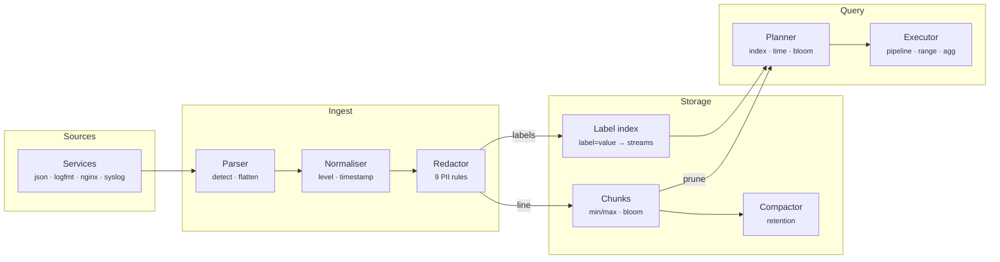

# Prism Logs — Architecture

Most log platforms either index everything (expensive) or nothing (slow). Prism Logs follows the Loki design: index a handful of labels, keep the raw lines in compressed-friendly chunks, and make brute-force scanning cheap by pruning chunks with time ranges and bloom filters. On top sits a LogQL engine, so the same query language that finds one bad request also turns logs into metrics and alerts. Redaction happens at ingest, so secrets never reach storage.

## System diagram

## How it works

1. **Parse** — Each line's format is detected, fields are extracted and flattened, and level and timestamp are normalised.
2. **Redact** — Nine rules mask PII and secrets in the raw line. Counts per rule are tracked for compliance reporting.
3. **Label** — Static labels (service, env) plus the normalised level form the stream key. High-cardinality fields stay in the line.
4. **Chunk** — Lines append to the stream's open chunk, which updates min/max time and the trigram bloom, then seals at 512 lines or 10 minutes.
5. **Query** — The planner resolves streams through the label index, prunes chunks by time and bloom, then streams lines through the compiled pipeline and range/vector aggregations.

## Design decisions

- **Index labels, not content.** The inverted index maps `label=value` to stream keys. Equality matchers intersect sets, regex and negative matchers filter the candidates. A cardinality limit rejects new streams instead of exploding memory.
- **Trigram blooms per chunk.** Substring filters are the most common log query. Packing each trigram into a 24-bit integer and double-hashing it into a 32 Kbit filter gives no false negatives, a low false-positive rate for 512-line chunks, and skips most chunks for rare needles.
- **Compiled pipelines.** Each stage compiles to a closure once per query. Parsers write into `fields`, filters read labels plus fields, so `| json | status >= 500` behaves exactly like LogQL.
- **Extracted labels stay cheap.** Range aggregations keep extracted labels only when an outer `by (...)` references them, which avoids building a series per request id.
- **Redact before storing.** Masking happens on the raw line before chunking and bloom indexing, so masked values cannot be found by search or leaked by retention.

## Production notes

This is a complete single-process engine. To run it at scale:

- Compress sealed chunks (gzip/zstd/snappy) and write them to object storage, with the label index in a small KV (BoltDB, DynamoDB, Postgres).
- Shard ingest by stream hash with a write-ahead log and replication factor 3, and split queries by time range across queriers.
- Add tenant isolation (`X-Scope-OrgID`) and per-tenant limits on ingestion rate, streams and query bytes.
- Expose a Loki-compatible HTTP API (`/loki/api/v1/push`, `/query_range`) so Grafana and Promtail/Vector work unchanged.
- Review redaction rules for your data. Regex redaction reduces risk but is not a guarantee.
